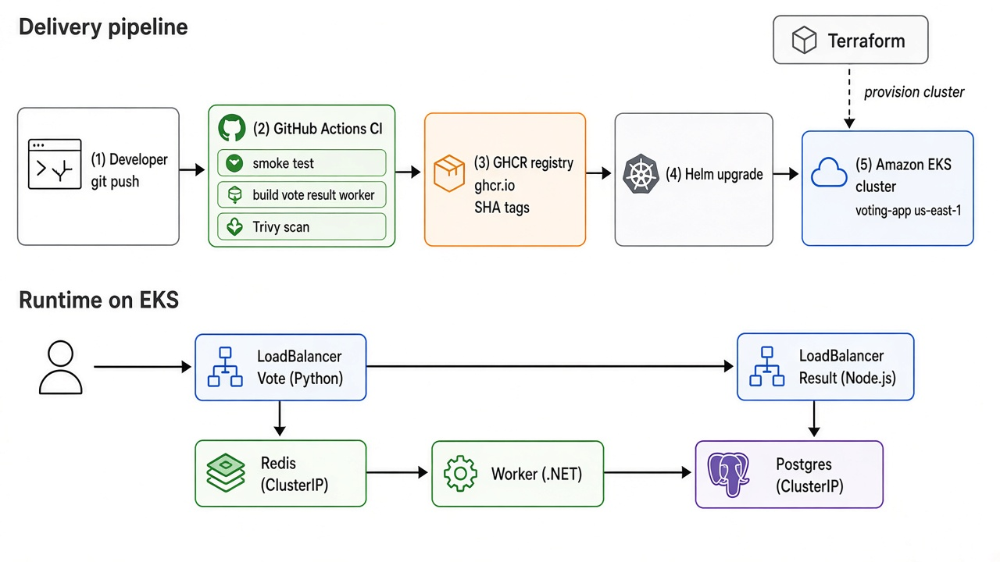

# Example Voting App

A simple distributed application running across multiple Docker containers.

## Getting started

Download [Docker Desktop](https://www.docker.com/products/docker-desktop) for Mac or Windows. [Docker Compose](https://docs.docker.com/compose) will be automatically installed. On Linux, make sure you have the latest version of [Compose](https://docs.docker.com/compose/install/).

This solution uses Python, Node.js, .NET, with Redis for messaging and Postgres for storage.

Run in this directory to build and run the app:

```shell
docker compose up
```

The `vote` app will be running at [http://localhost:8080](http://localhost:8080), and the `results` will be at [http://localhost:8081](http://localhost:8081).

Alternately, if you want to run it on a [Docker Swarm](https://docs.docker.com/engine/swarm/), first make sure you have a swarm. If you don't, run:

```shell
docker swarm init
```

Once you have your swarm, in this directory run:

```shell
docker stack deploy --compose-file docker-stack.yml vote
```

## Run the app in Kubernetes

Raw manifests live in `k8s-specifications/`. Prefer Helm for deploy:

```shell
helm upgrade --install voting-app ./charts/voting-app \
  --namespace voting-app --create-namespace
```

Or apply the plain specs:

```shell
kubectl create -f k8s-specifications/
```

## Terraform (kind / EKS)

- Local kind cluster: `terraform/README.md` and `terraform/`
- AWS EKS (us-east-1, default VPC): `terraform/aws/`

```shell
cd terraform/aws
terraform init
terraform apply
aws eks update-kubeconfig --region us-east-1 --name voting-app
```

Destroy with `terraform destroy` when you are done (EKS incurs cost).

## CI/CD (GitHub Actions)

One push to `main` runs smoke tests, builds `vote` / `result` / `worker`, scans with Trivy (fails on CRITICAL), pushes SHA-tagged images to GHCR, then Helm-deploys to EKS.

Workflow: [`.github/workflows/ci.yaml`](.github/workflows/ci.yaml)

### GitHub secrets (Settings → Secrets and variables → Actions)

| Secret | Purpose |
|--------|---------|
| `AWS_ACCESS_KEY_ID` | IAM user/key that can update kubeconfig and talk to EKS |
| `AWS_SECRET_ACCESS_KEY` | Matching secret key |
| `AWS_REGION` | e.g. `us-east-1` |

No AWS keys belong in Git. Images go to `ghcr.io/shemaiahyaba/example-voting-app-{vote,result,worker}:<sha>`.

If EKS cannot pull images, open each package on GitHub → Package settings → Change visibility → Public (the workflow also tries to set this).

### Helm rollback demo

1. Deploy a known-good release (CI on `main`, or local `helm upgrade`).
2. Ship a bad release on purpose:

```shell
helm upgrade voting-app ./charts/voting-app \
  --namespace voting-app \
  --set vote.image.tag=does-not-exist \
  --wait --timeout 2m || true
```

3. Confirm pods are failing, then roll back:

```shell
helm history voting-app -n voting-app
helm rollback voting-app -n voting-app
kubectl get pods -n voting-app
```

## Architecture

### Delivery (Terraform + CI/CD + Helm)



Push to `main` → GitHub Actions (test, build, Trivy) → GHCR (`:sha`) → Helm on EKS. Terraform provisions the `voting-app` cluster in the default VPC.

### Runtime (app)


* A front-end web app in [Python](/vote) which lets you vote between two options
* A [Redis](https://hub.docker.com/_/redis/) which collects new votes
* A [.NET](/worker/) worker which consumes votes and stores them in…
* A [Postgres](https://hub.docker.com/_/postgres/) database backed by a Docker volume
* A [Node.js](/result) web app which shows the results of the voting in real time

## Notes

The voting application only accepts one vote per client browser. It does not register additional votes if a vote has already been submitted from a client.

This isn't an example of a properly architected perfectly designed distributed app... it's just a simple
example of the various types of pieces and languages you might see (queues, persistent data, etc), and how to
deal with them in Docker at a basic level.
